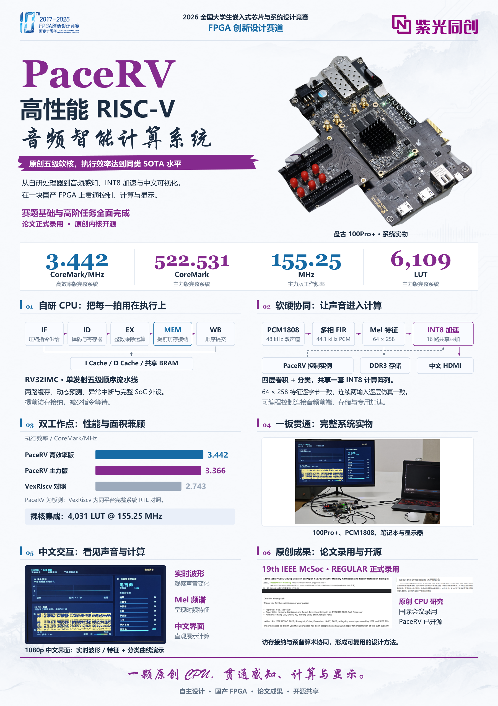

<p align="center">
  
  &nbsp;&nbsp;&nbsp;
  
</p>

# PaceRV · 高性能处理器与音频智能计算系统

**2026 嵌赛 FPGA 创新设计赛道 · 紫光同创赛题**

自主设计的单发射五级顺序 RV32IMC 软核，连接音频采集、硬件特征提取、INT8 神经网络加速和中文 HDMI 可视化。**PaceRV 执行效率达到同类 SOTA 水平**，相关研究获 **19th IEEE McSoc** 录用，源码与构建工具在此公开。

从 CPU 性能测试到最终音频功能展示，作品统一使用 **盘古 100Pro+** 开发板，FPGA 为 **PG2L100H-6IFBG676**。

## 评委阅读入口

| 内容 | 入口 |
| --- | --- |
| 作品技术报告 | [PDF](materials/PaceRV_作品技术报告.pdf) · [可编辑 Word](materials/editable/PaceRV_作品技术报告.docx) |
| 三分钟讲解 | [PPT](materials/PaceRV_嵌赛FPGA_三分钟讲解.pptx) · [逐页讲解稿](materials/PaceRV_三分钟逐页讲解稿.md) |
| 作品海报 | [A1 PDF](materials/PaceRV_作品海报.pdf) · [10,000 像素高清 PNG](materials/PaceRV_作品海报_高清.png) · [可编辑 SVG](materials/editable/PaceRV_作品海报.svg) |
| 全部工程源码 | [hardware/](hardware/) · [13 个工程配置](hardware/projects.json) |
| 构建、烧录与测量 | [100Pro+ 使用说明](hardware/docs/BUILD_AND_RUN.md) |
| 验证结果 | [源码包检查记录](hardware/docs/PACKAGE_STATUS.md) · [机器可读结果](hardware/docs/validation/results.json) |
| 实物照片与观测波形 | [完整系统与开发板](materials/photos/) · [CPU 仿真波形与 CSV](materials/waveforms/) |
| 学术成果 | [论文与研究材料](https://github.com/BXSYGJ/PaceRV-MCSoC2026) |

## 处理器与完整系统

PaceRV 把压缩指令前端、分支预测、缓存与提前访存接纳协同设计，在紧凑五级流水线中提高指令供给和执行效率。两套 CPU 工程均保留 RV32IMC、缓存、CSR、异常中断、UART、GPIO、定时器和运行监测。

| CPU 发布配置 | 时钟 / MHz | CoreMark | CoreMark/MHz | LUT | FF | BRAM | DSP |
| --- | ---: | ---: | ---: | ---: | ---: | ---: | ---: |
| Original · 主力性能版 | 155.25 | 522.531 | 3.366 | 6,109 | 2,864 | 21 | 4 |
| H3 Base · 高执行效率版 | 145.125 | 499.506 | 3.442 | 6,097 | 2,541 | 25 | 4 |

上表汇总既有完整系统发布测量；冻结固件及对应串口参考保存在各工程的 `firmware/V0/`、`firmware/V1/`。本次便携工程的新增验证为三项 PDS 编译和 56 项测试，具体范围见[验证说明](hardware/docs/PACKAGE_STATUS.md)。在新电脑重建时，将新生成的位流、时序报告与串口采集配套保存。

音频应用在同一块 100Pro+ 上集成 PCM1808、48→44.1 kHz 多相 FIR、64×258 Mel 特征、16 路 INT8 卷积加速、DDR3 与 1080p 中文界面。RV32 控制程序通过 MMIO 调度任务，专用硬件完成高吞吐数据处理。

## 快速开始

安装 Python、PowerShell 7+ 与 PDS 2022.2-SP6.4，配置 PG2L100H 器件支持和许可证。克隆仓库后进入 `hardware/`，运行：

```powershell
python -m pip install -r requirements.txt
python tools/verify_package.py
pwsh -File tools/Build-PDS.ps1 -Project performance_155250_V0 -PrepareOnly
pwsh -File tools/Build-PDS.ps1 -Project performance_155250_V0 -StopAfter compile
pwsh -File tools/Build-PDS.ps1 -Project efficiency_145125_V0 -StopAfter compile
pwsh -File tools/Build-PDS.ps1 -Project application_full -StopAfter compile
```

PDS 路径、完整位流构建、JTAG 下载、CPU 串口计数、音频模型加载与独立诊断工程均见[详细使用说明](hardware/docs/BUILD_AND_RUN.md)。CPU 性能工程使用 **9,600 baud**；音频应用使用 **115,200 baud**。

## 开源与学术成果

- **本仓库 PaceRV**：本次 FPGA 竞赛的评审与交付入口，集中源码、工程配置、技术报告、PPT、海报和使用说明。
- **[PaceRV-MCSoC2026](https://github.com/BXSYGJ/PaceRV-MCSoC2026)**：相关论文的复现实验材料。

<p align="center"></p>

## 许可

原创源码采用 [MIT License](LICENSE)。CoreMark、供应商 IP、模型依赖和作品材料分别保留其版权与许可，见 [THIRD_PARTY_NOTICES.md](THIRD_PARTY_NOTICES.md)。开发软件与许可证由使用者自行安装。
